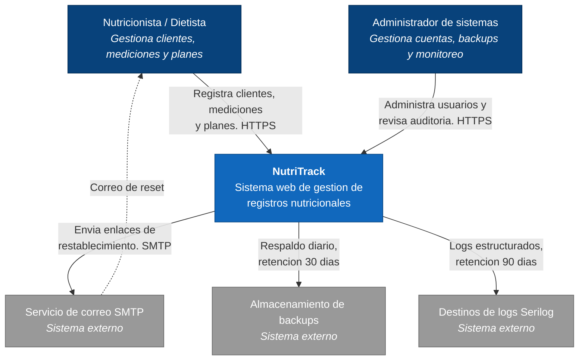
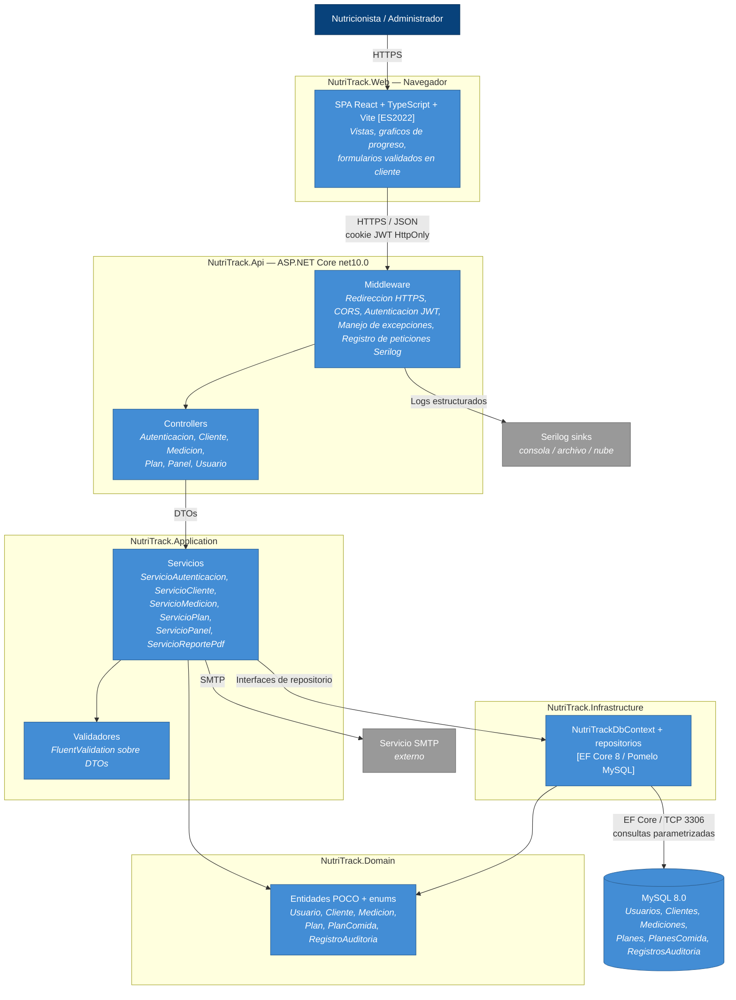
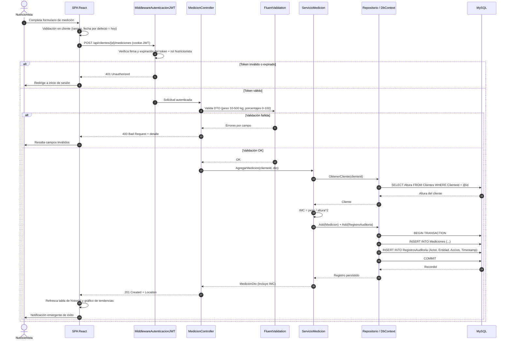
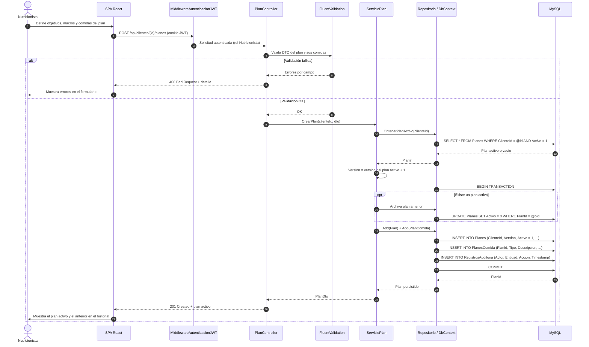
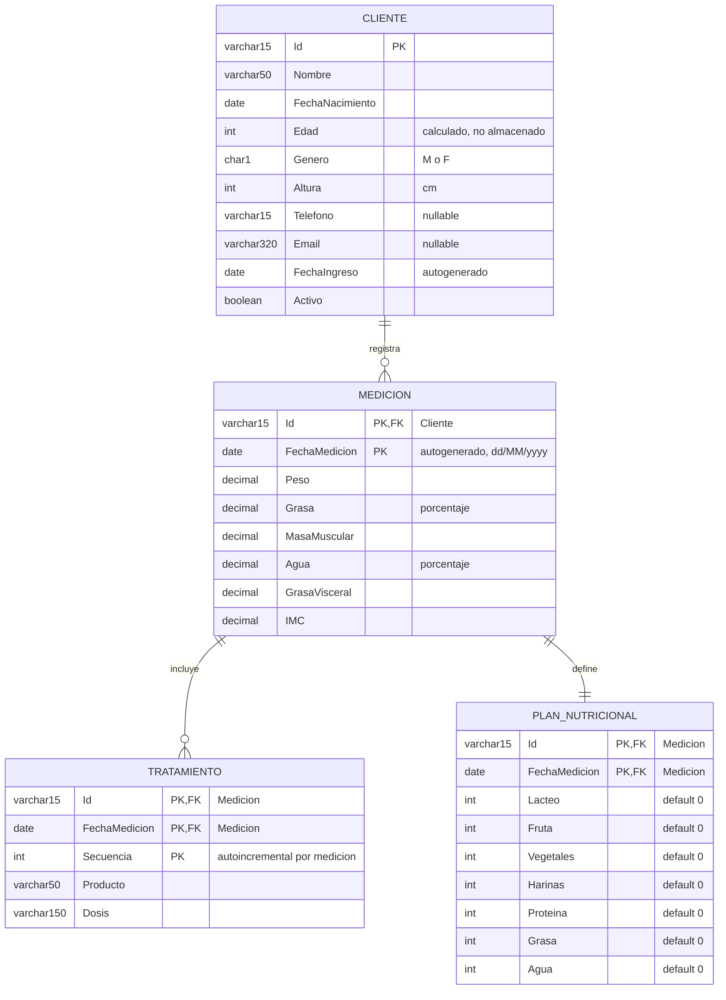

## Índice

1. [Ficha del proyecto](#1-ficha-del-proyecto)
   - [1.1 Responsable del proyecto](#11-responsable-del-proyecto)
   - [1.2 Nombre del Proyecto](#12-nombre-del-proyecto)
   - [1.3 Resumen Ejecutivo](#13-resumen-ejecutivo)
   - [1.4 Stack tecnológico](#14-stack-tecnológico)
   - [1.5 URL del repositorio](#15-url-del-repositorio)
   - [1.6 Cómo ejecutar el proyecto](#16-cómo-ejecutar-el-proyecto)
2. [Objetivo y alcance](#2-objetivo-y-alcance)
   - [2.1 Objetivos](#21-objetivos)
   - [2.2 Alcance (MVP)](#22-alcance-mvp)
   - [2.3 Fuera del alcance (MVP)](#23-fuera-del-alcance-mvp)
3. [Características y funcionalidades del proyecto](#3-características-y-funcionalidades-del-proyecto)
4. [Arquitectura del sistema](#4-arquitectura-del-sistema)
   - [4.1 Patrón arquitectónico: capas N-tier](#41-patrón-arquitectónico-capas-n-tier)
   - [4.2 Diagrama C4 — Nivel 1: Contexto](#42-diagrama-c4--nivel-1-contexto)
   - [4.3 Diagrama C4 — Nivel 2: Contenedores](#43-diagrama-c4--nivel-2-contenedores)
   - 4.4 Diagrama de secuencia — US-001: Inicio de sesión (JWT) _(pendiente de documentar; autenticación fuera del MVP)_
   - [4.5 Diagrama de secuencia — US-008: Registrar medición de composición corporal](#45-diagrama-de-secuencia--us-008-registrar-medición-de-composición-corporal)
   - [4.6 Diagrama de secuencia — US-011: Crear y asignar un plan nutricional](#46-diagrama-de-secuencia--us-011-crear-y-asignar-un-plan-nutricional)
   - [4.7 Arquitectura de seguridad (transversal)](#47-arquitectura-de-seguridad-transversal)
   - [4.8 Diagrama de base de datos](#48-diagrama-de-base-de-datos)
5. [Especificación de la API](./docs/API-Controllers.md)
6. [Historias de Usuario](./docs/backlog-NutriTrack.md)
7. [Tickets de Trabajo](#7-tickets-de-trabajo)
8. [Pull Requests](#8-pull-requests)
9. [Pruebas](#9-pruebas)
10. [Despliegue](#10-despliegue)

## 1. Ficha del proyecto

### **1.1 Responsable del proyecto:**
Jeinner Cordero Meza

### **1.2 Nombre del Proyecto**
NutriTrack

### **1.3 Resumen Ejecutivo**
NutriTrack es un sistema web de gestión de registros nutricionales diseñado para que nutricionistas y dietistas administren su cartera de clientes. El sistema centraliza los datos demográficos de los clientes, las métricas de composición corporal, los planes nutricionales y el historial de progreso en una plataforma única, segura y fácil de utilizar.

El proyecto sigue la metodología Agile/Scrum, organizada en 4 sprints de 2 semanas cada uno, con el objetivo de entregar un MVP en aproximadamente 8-10 semanas.

### **1.4 Stack tecnológico**
La solución se basa en el siguiente conjunto de tecnologías:
- .NET 10 (`net10.0`, ASP.NET Core Web API) — Backend REST API y lógica de negocios.
- C# 14 — Lenguaje de programación del lado del servidor (versión por defecto de .NET 10).
- Entity Framework Core 8 + Pomelo MySQL 8.x — ORM para acceso y migraciones de bases de datos con tipado seguro. Se mantiene la versión 8.x a propósito aunque el target sea `net10.0`.
- FluentValidation — Validación de DTOs en el servidor.
- MySQL 8 — Motor de base de datos relacional
- React 19 + TypeScript + Vite — HTML5 / CSS3 / TypeScript (ES2022) — Interfaz de usuario frontend responsiva (SPA).
- Bootstrap 5.3.8 (solo CSS) — Estilos y componentes visuales.
- jsPDF + jspdf-autotable — Generación y descarga del PDF del historial de progreso en el navegador (carga diferida, sin enviar datos a un servidor externo).
- MySqlConnector 2.6.2 — Driver MySQL, fijado explícitamente en `Infrastructure` para reemplazar la 2.3.5 que trae Pomelo (vulnerabilidad GHSA-473q-m89c-ghf8, corregida en 2.6.1).
- react-router-dom — Enrutamiento de la SPA. oxlint — Linter del frontend.
- xUnit — Pruebas unitarias y de integración (.NET).
- vitest + Testing Library — Pruebas unitarias del frontend. Playwright — Pruebas E2E (ver sección 9).

### **1.5 URL del repositorio**
En esta sección encontrará la URL del repositorio del proyecto, no se cargará el main si no el feature branch que corresponda a la etapa a entregar.

Rama entrega 1: https://github.com/Jcordero4/AI4Devs-finalproject/tree/feature/entrega-1-JJCM

Rama entrega 2: https://github.com/Jcordero4/AI4Devs-finalproject/tree/feature/entrega-2-JJCM

Rama entrega final: https://github.com/Jcordero4/AI4Devs-finalproject/tree/feature/final-project-JJCM

### **1.6 Cómo ejecutar el proyecto**

**Requisitos previos**

- [.NET 10 SDK](https://dotnet.microsoft.com/download)
- [Node.js](https://nodejs.org/) 24 (con npm)
- MySQL 8 en ejecución (por defecto en `localhost:3306`)
- Herramienta de migraciones de EF Core: `dotnet tool install --global dotnet-ef`

**1. Clonar y cambiar a la rama de la entrega**

```bash
git clone https://github.com/Jcordero4/AI4Devs-finalproject.git
cd AI4Devs-finalproject
git checkout feature/entrega-2-JJCM
```

**2. Crear la base de datos y configurar la conexión**

Crear la base vacía en MySQL:

```sql
CREATE DATABASE nutritrackdb CHARACTER SET utf8mb4;
```

`API/appsettings.json` solo trae placeholders (`CHANGE_ME`). Crear `API/appsettings.Development.json` (está en `.gitignore`, no se sube al repositorio) con las credenciales reales:

```json
{
  "ConnectionStrings": {
    "DefaultConnection": "Server=localhost;Port=3306;Database=nutritrackdb;User=SU_USUARIO;Password=SU_CLAVE;"
  }
}
```

**3. Aplicar las migraciones** (la API no crea las tablas sola)

```bash
dotnet ef database update --project Infrastructure --startup-project API
```

**4. Levantar la API**

```bash
dotnet dev-certs https --trust      # solo la primera vez: confía el certificado HTTPS de desarrollo
dotnet run --project API
```

- API: https://localhost:7054 (también http://localhost:5167)
- Swagger UI (solo en Development): https://localhost:7054/swagger
- Health check: https://localhost:7054/health

**5. Levantar el frontend** (en otra terminal)

```bash
cd Web
npm install
npm run dev
```

Abrir http://localhost:5173. El frontend llama a la API en la URL de `VITE_API_URL` (`Web/.env.development`, por defecto `https://localhost:7054`). La API solo acepta peticiones del origen configurado en `Cors:AllowedOrigins` (por defecto `http://localhost:5173`).

**Problemas frecuentes**

| Síntoma | Causa y solución |
|---|---|
| El listado muestra "No se pudo cargar el listado de clientes." | La API no está levantada, el certificado HTTPS no es de confianza (`dotnet dev-certs https --trust`) o faltan las migraciones (paso 3). |
| `Access denied` o error de conexión al arrancar o migrar | Revisar usuario, clave y puerto en `API/appsettings.Development.json`, y que MySQL esté corriendo. |
| Error de CORS en la consola del navegador | El frontend se abrió en un puerto distinto de 5173; agregarlo a `Cors:AllowedOrigins`. |
| `dotnet ef` no se reconoce | Instalar la herramienta: `dotnet tool install --global dotnet-ef`. |

Para ejecutar las pruebas, ver la sección [9. Pruebas](#9-pruebas). El video `Ejemplo Ejecucion/` muestra la aplicación en funcionamiento.

## 2. Objetivo y alcance.

### **2.1 Objetivos**
1.	Proporcionar un registro digital centralizado para los datos nutricionales y personales de los clientes.
2.	Permitir que los nutricionistas realicen un seguimiento del progreso de sus clientes a lo largo del tiempo mediante registros de composición corporal.
3.	Permite la creación, asignación y gestión de planes nutricionales personalizados.
4.	Ofrecer una interfaz de usuario limpia y adaptable, accesible desde navegadores de escritorio.
5.	Garantizar la integridad de los datos, la seguridad y el control de acceso basado en roles.

### **2.2 Alcance (MVP)**
- Gestión de clientes: operaciones CRUD completas
- Seguimiento de la composición corporal (peso, porcentaje de masa muscular, porcentaje de grasa corporal, nivel de agua, IMC)
- Creación, asignación e historial del plan nutricional
- Interfaz web adaptable
- Exportación a PDF del informe de progreso del cliente

### **2.3 Fuera del alcance (MVP)**
- Aplicaciones móviles nativas (iOS/Android)
- Integración con sistemas de laboratorio externos o dispositivos portátiles.
- Generación de planes de comidas mediante IA
- Módulo de pago o facturación
- Soporte multilingüe / i18n
- Autenticación de usuario para nutricionistas y cliente (JWT) y autorización basada en roles. Apesar de que esto se encuentra en el documento de especificación del proyecto se saca para esta MVP a presentar.

## 3. Características y funcionalidades del proyecto

- Autenticacion del usuario
- Gestión de clientes
- Ver perfil completo del cliente
- Registro de composición corporal
- Generacion del reporte de progreso para el cliente en PDF
- Gestión de Planes nutricionales.

**Estado actual del MVP** (esta lista es el objetivo del producto; no todo está implementado todavía):

| Funcionalidad | Estado |
|---|---|
| Gestión de clientes: listar, filtrar, crear, editar (US-004) | Implementado |
| Registro de composición corporal con tratamiento y plan de nutrición por medición (US-008) | Implementado |
| Historial de progreso, gráfico de peso y descarga en PDF (US-009) | Implementado |
| Pruebas unitarias, de integración y E2E | Implementado (ver sección 9) |
| Autenticación JWT y roles | Fuera del MVP (ver 2.3) |
| Plan nutricional versionado (US-011 a US-013), correo SMTP, auditoría, Serilog | Planeado; aparece en los diagramas 4.2 a 4.7 como diseño objetivo |

## 4. Arquitectura del sistema

<!-- Los diagramas usan `flowchart`/`sequenceDiagram` de Mermaid en lugar de `C4Context`/`C4Container`:
     el soporte C4 de Mermaid sigue siendo experimental y no renderiza de forma consistente en GitHub. -->

### **4.1 Patrón arquitectónico: capas N-tier**

NutriTrack usa una arquitectura limpia de N capas con separación estricta de responsabilidades.

| Capa | Tecnología | Responsabilidad |
|---|---|---|
| Presentación | React + TypeScript (Vite) + react-router-dom — Bootstrap 5.3.8 / HTML5 / CSS3 / ES2022 | Renderiza la UI, gestiona eventos de usuario y consume la API vía `fetch` con `credentials: 'include'`. |
| API | ASP.NET Core Web API (`net10.0`) | Expone endpoints RESTful, enrutamiento HTTP, middleware de autenticación/CORS/errores y formato de respuesta. |
| Lógica de negocio | Servicios C# + FluentValidation | Valida entradas, aplica reglas de negocio y coordina las llamadas a la capa de datos. |
| Acceso a datos | Entity Framework Core 8 (provider Pomelo MySQL) | Mapea entidades a tablas MySQL; consultas LINQ, relaciones y migraciones. |
| Base de datos | MySQL 8.0 | Almacenamiento persistente: clientes, mediciones, planes, usuarios y auditoría. |

**Proyectos de la solución** (`NutriTrack.slnx`):

| Proyecto | Carpeta | Contenido |
|---|---|---|
| NutriTrack.Api | `API/` | Controllers, middleware, DI, `Program.cs`, `appsettings.json` |
| NutriTrack.Application | `Application/` | Servicios de aplicación, DTOs, interfaces, validadores FluentValidation |
| NutriTrack.Domain | `Domain/` | Entidades POCO, enums y constantes de negocio — cero referencias a EF Core |
| NutriTrack.Infrastructure | `Infrastructure/` | `DbContext`, provider Pomelo MySQL, repositorios, migraciones |
| NutriTrack.Web | `Web/` | Frontend React + TypeScript (Vite): componentes, hooks, servicios de API |
| NutriTrack.Tests | `Test/` | xUnit: pruebas unitarias (servicios) e integración (endpoints) |

### **4.2 Diagrama C4 — Nivel 1: Contexto**



### **4.3 Diagrama C4 — Nivel 2: Contenedores**



### **4.5 Diagrama de secuencia — US-008: Registrar medición de composición corporal**



### **4.6 Diagrama de secuencia — US-011: Crear y asignar un plan nutricional**



### **4.7 Arquitectura de seguridad (transversal)**

- **Autenticación:** JWT emitido en el login, almacenado en cookie `HttpOnly` + `Secure` (TTL 8 h) para evitar robo por XSS.
- **Autorización:** basada en roles (Nutricionista / Administrador) mediante `[Authorize(Roles = "...")]`.
- **Contraseñas:** hash BCrypt con rondas de sal ≥ 12; nunca se almacenan ni se registran en texto plano.
- **Transporte:** HTTPS obligatorio en todos los entornos; HTTP redirigido a HTTPS.
- **CORS:** política restringida al origen del frontend propio.
- **Validación:** validación en cliente (React) + FluentValidation en servidor sobre todos los DTOs.
- **Inyección SQL:** EF Core con consultas parametrizadas exclusivamente; SQL sin procesar prohibido.
- **Auditoría:** toda operación de creación/actualización/eliminación escribe en `AuditLogs` (actor, marca de tiempo, valores modificados), en la misma transacción que el cambio.

### **4.8 Diagrama de base de datos**

Modelo entidad-relación del dominio de Cliente y Composición Corporal, basado en `docs/US-004-CRUD-Cliente.md`, `docs/US-008-Medicion-Composicion-Corporal.md` y `docs/US-009-Historial-Progreso-Graficos.md` (US-009 es de solo consulta y reutiliza las entidades de US-008, no agrega entidades propias). Los nombres siguen la convención en español usada en esos documentos.



**Definición de tablas:**

Detalle de campos tomado de los catálogos de los US indicados. Tipos en notación del US (`Varchar(n)`, `Char`, `Decimal(p,s)`).

#### Cliente

Fuente: `docs/US-004-CRUD-Cliente.md`.

| # | Campo | Tipo | Obligatorio | Reglas |
|---|-------|------|:---:|--------|
| 1 | Id | Varchar(15) | Sí | PK. Representa cédula o pasaporte. Debe ser único. Inmutable después de creado. |
| 2 | Nombre | Varchar(50) | Sí | Se crea índice para agilizar búsquedas. |
| 3 | FechaNacimiento | Fecha | Sí | — |
| 4 | Edad | Entero | Sí | Autocalculada a partir de FechaNacimiento. No editable, nunca negativa. En el modelo físico no se almacena. |
| 5 | Genero | Char('M'\|'F') | Sí | M = Masculino, F = Femenino. Base para cálculo de composición corporal y plan nutricional. |
| 6 | Altura | Entero | Sí | En centímetros. Debe ser mayor a 0. |
| 7 | Telefono | Varchar(15) | No | Si se ingresa, solo dígitos con un `+` inicial opcional (código de país); sin letras, guiones, espacios ni paréntesis. Mínimo 7 dígitos y máximo 15 caracteres en total (`^\+?\d{7,15}$`). Vacío se guarda como nulo. |
| 8 | Email | Varchar(320) | No | Si se ingresa, debe cumplir formato de correo válido (`texto@dominio.tld`). |
| 9 | FechaIngreso | Fecha | Sí | Asignada automáticamente con la fecha actual al crear el cliente. No editable. |
| 10 | Activo | Booleano | Sí | Por defecto `true` al crear. No editable manualmente en US-004. |

#### Medicion

Fuente: `docs/US-008-Medicion-Composicion-Corporal.md` (US-009 solo consulta estos datos).

| # | Campo | Tipo | Obligatorio | Reglas |
|---|-------|------|:---:|--------|
| 1 | Id | Varchar(15) | Sí | PK compuesta (junto a FechaMedicion). FK a Cliente. |
| 2 | FechaMedicion | Fecha | Sí | PK compuesta (junto a Id). Se autocompleta con la fecha actual, sin hora, formato `dd/MM/yyyy`. No editable. |
| 3 | Peso | Decimal(10,2) | Sí | Valor positivo. |
| 4 | Grasa | Decimal(10,2) | Sí | Porcentaje de grasa corporal. Valor positivo. |
| 5 | MasaMuscular | Decimal(10,2) | Sí | Valor positivo. |
| 6 | Agua | Decimal(10,2) | Sí | Porcentaje de agua corporal. Valor positivo. |
| 7 | GrasaVisceral | Decimal(10,2) | Sí | Valor positivo. |
| 8 | IMC | Decimal(10,2) | Sí | Índice de Masa Corporal. Valor positivo. |

#### Tratamiento

Fuente: `docs/US-008-Medicion-Composicion-Corporal.md`.

| # | Campo | Tipo | Obligatorio | Reglas |
|---|-------|------|:---:|--------|
| 1 | Id | Varchar(15) | Sí | FK a Medicion (una medición puede tener varias filas de tratamiento). |
| 2 | Secuencia | Entero | Sí | PK compuesta junto a Id. Autoincremental por medición; identifica cada fila de tratamiento. |
| 3 | Producto | Varchar(50) | Sí | — |
| 4 | Dosis | Varchar(150) | Sí | — |

> El US define la PK como (`Id`, `Secuencia`); el diagrama la extiende con `FechaMedicion` porque la llave de `Medicion` es compuesta (ver notas del modelo).

#### Plan_Nutricional

Fuente: `docs/US-008-Medicion-Composicion-Corporal.md`.

| # | Campo | Tipo | Obligatorio | Reglas |
|---|-------|------|:---:|--------|
| 1 | Id | Varchar(15) | Sí | PK y FK a Medicion (una fila de plan nutricional por medición). |
| 2 | Fecha | Fecha | Sí | Corresponde a la `FechaMedicion` de la medición asociada; no se captura por separado en la UI. En el diagrama se nombra `FechaMedicion`. |
| 3 | Lacteo | Entero | Sí | Valor por defecto 0. |
| 4 | Fruta | Entero | Sí | Valor por defecto 0. |
| 5 | Vegetales | Entero | Sí | Valor por defecto 0. |
| 6 | Harinas | Entero | Sí | Valor por defecto 0. |
| 7 | Proteina | Entero | Sí | Valor por defecto 0. |
| 8 | Grasa | Entero | Sí | Valor por defecto 0. |
| 9 | Agua | Entero | Sí | Valor por defecto 0. |

**Notas del modelo:**
- **Telefono** se agrega a `Cliente` (opcional, `Varchar(15)`, solo dígitos con un `+` inicial opcional) porque la Pantalla de Listado de US-004 lo muestra como columna, aunque el catálogo de campos original no lo listaba; se incorporó al catálogo de US-004 y al código (change `agregar-telefono-cliente`).
- **Secuencia** se agrega a `Tratamiento` porque una medición admite varios productos ("Nuevo Producto" en la UI); con solo `Id` como llave no era posible guardar más de una fila por medición.
- La llave foránea de `Tratamiento` y `Plan_Nutricional` hacia `Medicion` es compuesta (`Id` + `FechaMedicion`), no solo `Id`, porque la llave primaria de `Medicion` también es compuesta — un `Id` de cliente por sí solo no identifica una medición específica.
- `Plan_Nutricional` es 1:1 con `Medicion` (una fila de plan por cada medición); `Tratamiento` es 1:N (cero o varias filas por medición).
- Esta tabla `Plan_Nutricional` (distribución de porciones por grupo alimenticio, ligada a una medición) es un concepto distinto del "Plan nutricional" versionado del Epic 4 (US-011 a US-013: título, objetivo, macros, horario de comidas); ese último no forma parte de este diagrama por no estar cubierto en US-004/008/009.
- Los nombres de entidades aquí (`Cliente`, `Medicion`, `Tratamiento`, `Plan_Nutricional`) están en español, siguiendo `docs/US-004-CRUD-Cliente.md` y `docs/US-008-Medicion-Composicion-Corporal.md`. Las secciones 4.2 a 4.6 se actualizaron para usar los mismos nombres en español (`Cliente`, `Medicion`, `Plan`, `Usuario`, etc.); `Tratamiento` y `Plan_Nutricional` (sub-bloques de `Medicion`) no aparecen todavía en esos diagramas de contenedores/secuencia porque son anteriores al detalle documentado en US-008 — conviene incorporarlos ahí también más adelante.

> **Nota sobre el stack:** estos diagramas siguen el stack declarado en la sección 1.4 de este README (.NET 10, React 19 + TypeScript + Vite), que coincide con el `TargetFramework` real del proyecto (`API/NutriTrackAPI.csproj` → `net10.0`). El plan `docs/NutriTrack_Project_Plan_ESP.docx` se alineó con ese stack (2026-10-15).

## 7. Tickets de Trabajo
En esta sección se documentarán 3 tickets de trabajo principales del desarrollo, uno de backend, uno de frontend, y uno de bases de datos. Se da todo el detalle requerido para desarrollar la tarea de inicio a fin teniendo en cuenta las buenas prácticas al respecto.

## 8. Pull Requests
En este punto se documentan al menos 3 de los PR generados para el proyecto.

Pull Request 1:
Es la etapa de documentación técnica: Ficha del proyecto, descripción, arquitectura, modelo de datos, historias de usuario, tickets de trabajo.

## 9. Pruebas

El proyecto tiene pruebas unitarias, de integración y E2E. Los comandos se ejecutan desde la raíz del repositorio, salvo los marcados con `Web/`.

| Tipo | Ubicación | Comando |
|---|---|---|
| Unitarias API (.NET, xUnit) | `Test/Unit/` | `dotnet test Test --filter "FullyQualifiedName~NutriTrack.Tests.Unit"` |
| Integración API (`WebApplicationFactory` + EF InMemory) | `Test/Integration/` | `dotnet test Test --filter "FullyQualifiedName~NutriTrack.Tests.Integration"` |
| Smoke test API | `Test/Integration/ApiSmokeTests.cs` | `dotnet test Test --filter "FullyQualifiedName~ApiSmokeTests"` |
| Todas las de .NET | `Test/` | `dotnet test NutriTrack.slnx` |
| Unitarias Web (vitest + Testing Library) | `Web/src/**/*.test.ts(x)` | en `Web/`: `npm test` |
| E2E Web (Playwright) | `Web/e2e/` | en `Web/`: `npm run test:e2e` |

Filtros por clase: `~ClienteUnitTests`, `~MedicionUnitTests`, `~ClienteApiTests`, `~MedicionApiTests`.

### Ver la ejecución en detalle

- .NET, un renglón por test: agregar `--logger "console;verbosity=detailed"` a cualquier `dotnet test`.
- Web unitarias, un renglón por test: `npx vitest run --reporter=verbose`. Modo watch (se re-ejecuta al guardar): `npm run test:watch`.
- E2E con interfaz y línea de tiempo por paso: `npx playwright test --ui` (hacer clic en un test para ver sus pasos).
- E2E con navegador visible: `npx playwright test --headed --workers=1`. Para ralentizar cada acción: `$env:SLOWMO='800'` (PowerShell) o `SLOWMO=800` (bash) antes del comando.
- E2E paso a paso: `npx playwright test --debug`.
- E2E con reporte HTML: `npx playwright test --reporter=html` y luego `npx playwright show-report`.

### Requisitos previos

- Primera vez en `Web/`: `npm install` y `npx playwright install chromium`.
- Los E2E simulan la API con `page.route`: no necesitan backend ni base de datos. Levantan solos el servidor de Vite en el puerto 5174.
- Las pruebas de integración usan EF Core InMemory: no necesitan MySQL.

### Integración continua

`.github/workflows/ci.yml` ejecuta en cada PR hacia `main`: build y tests de .NET, y en `Web/` lint, build, tests unitarios y E2E.

## 10. Despliegue

La demo está desplegada en [Render](https://render.com) (API y frontend) con la base de datos en [TiDB Cloud](https://tidbcloud.com) (compatible con MySQL). Render no ofrece MySQL gestionado, por eso la BD es externa.

| Componente | Servicio | Tipo |
|---|---|---|
| API (.NET 10) | Render | Web Service (Docker) |
| Frontend (React + Vite) | Render | Static Site |
| Base de datos | TiDB Cloud Starter (gratuito) | MySQL compatible |

Archivos involucrados: `Dockerfile` y `.dockerignore` (imagen de la API) y `render.yaml` (Blueprint con ambos servicios).

### 10.1 Base de datos (TiDB Cloud)

1. Crear una cuenta en TiDB Cloud y un recurso **Starter** (plan gratuito), modo **MySQL Compatible**, en AWS. Elegir la misma región que se usará en Render (por ejemplo, N. Virginia / Virginia).
2. En el **SQL Editor** crear la base de datos:
   ```sql
   CREATE DATABASE nutritrackdb;
   ```
3. En **Connect** → **General**, generar la contraseña (se muestra una sola vez) y anotar host, puerto (`4000`) y usuario completo (con prefijo, por ejemplo `abc123.root`). El acceso público viene habilitado por defecto.
4. Armar la cadena de conexión (no versionarla; va solo en Render):
   ```
   Server=HOST;Port=4000;Database=nutritrackdb;User=PREFIJO.root;Password=PASSWORD;SslMode=Required;
   ```

Las tablas se crean solas en el primer arranque de la API (ver variable `Database__MigrarAlIniciar`).

### 10.2 API (Render, Docker)

1. Subir los cambios a GitHub (`Dockerfile`, `.dockerignore`, `render.yaml`). Render despliega desde la rama indicada en el Blueprint.
2. En Render: **New** → **Blueprint**, conectar el repositorio y elegir la rama. Render lee `render.yaml`.
3. Cargar las variables del servicio `nutritrack-api`:

   | Variable | Valor |
   |---|---|
   | `ConnectionStrings__DefaultConnection` | Cadena de conexión de TiDB (paso 10.1) |
   | `Cors__AllowedOrigins__0` | URL del frontend, sin barra final |
   | `Database__MigrarAlIniciar` | `true` (aplica las migraciones de EF al iniciar) |
   | `ASPNETCORE_ENVIRONMENT` | `Production` |

4. **Deploy Blueprint** y esperar el build. Verificar `https://<servicio>.onrender.com/health` (debe responder 200).

Detalles de la API para Render: escucha en el puerto de la variable `PORT`, respeta los headers `X-Forwarded-*` (Render termina el TLS) y la redirección a HTTPS solo se activa en Development. Swagger solo está disponible en Development.

### 10.3 Frontend (Render, Static Site)

El servicio `nutritrack-web` ya está definido en `render.yaml`: compila `Web/` con `npm ci && npm run build` y publica `dist`. Lleva:

- `VITE_API_URL` apuntando a la URL pública de la API.
- Un rewrite `/* → /index.html`, necesario para las rutas de react-router.

Pasos:

1. Hacer **Manual sync** del Blueprint (o esperar el auto-sync) para crear el Static Site.
2. Copiar la URL que Render asigna al frontend.
3. En el servicio `nutritrack-api` → **Environment**, poner esa URL en `Cors__AllowedOrigins__0` y guardar. Sin este paso el navegador bloquea las llamadas por CORS.

### 10.4 Notas

> **Nota:** esto es una demo en el plan gratuito de Render. La API se duerme tras 15 minutos sin tráfico, por lo que la primera petición tras un período de inactividad puede tardar unos 50 segundos mientras despierta. Hay que darle ese tiempo antes de asumir que falla. El frontend (Static Site) no se duerme.

### 10.5 Proyecto desplegado

Para ver el proyecto desplegado puedes ingresar en: https://nutritrack-web-e5kf.onrender.com/clientes
