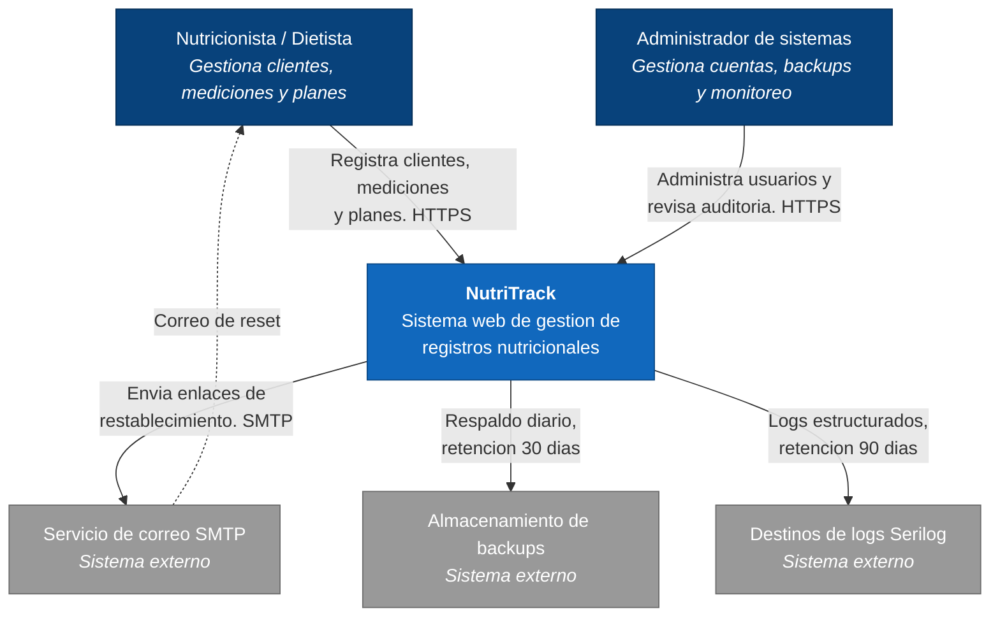
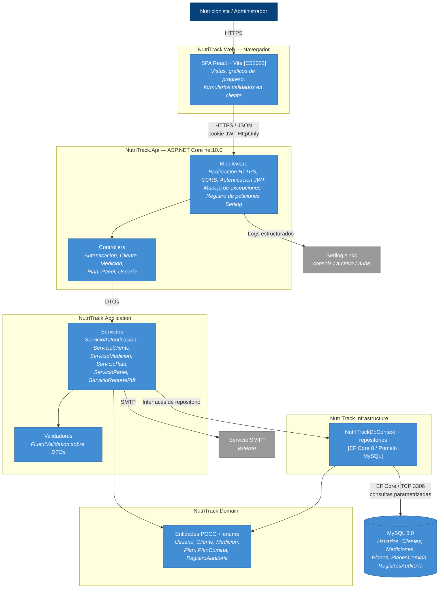
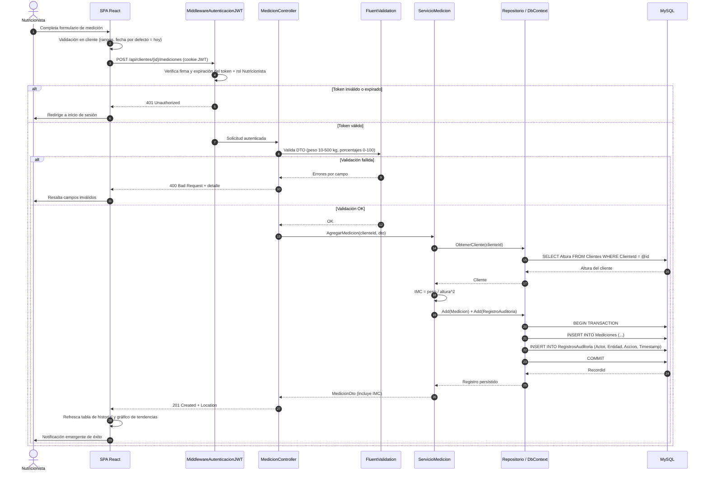
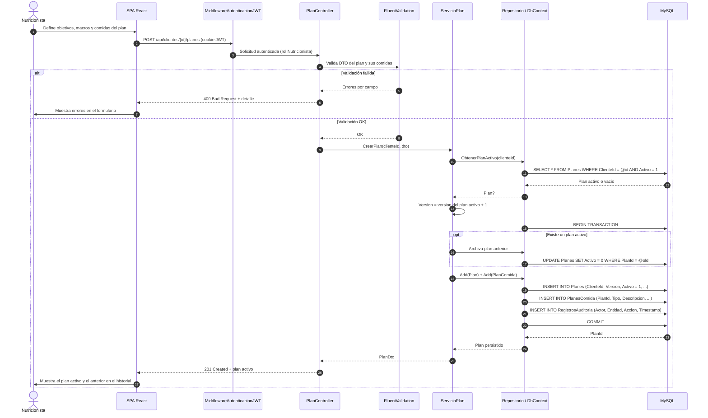
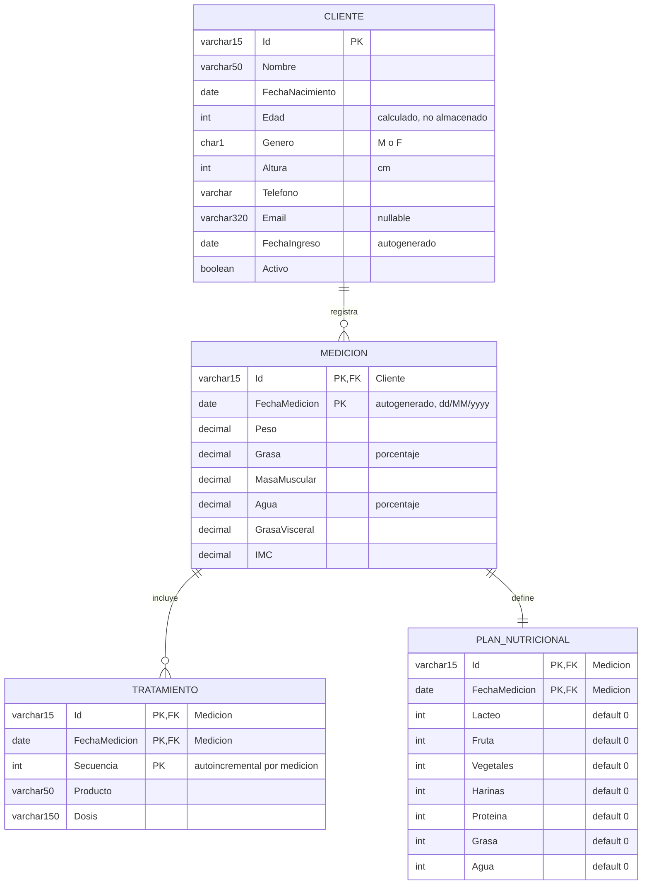

## Índice

1. [Ficha del proyecto](#1-ficha-del-proyecto)
   - [1.1 Responsable del proyecto](#11-responsable-del-proyecto)
   - [1.2 Nombre del Proyecto](#12-nombre-del-proyecto)
   - [1.3 Resumen Ejecutivo](#13-resumen-ejecutivo)
   - [1.4 Stack tecnológico](#14-stack-tecnológico)
   - [1.5 URL del repositorio](#15-url-del-repositorio)
2. [Objetivo y alcance](#2-objetivo-y-alcance)
   - [2.1 Objetivos](#21-objetivos)
   - [2.2 Alcance (MVP)](#22-alcance-mvp)
   - [2.3 Fuera del alcance (MVP)](#23-fuera-del-alcance-mvp)
3. [Características y funcionalidades del proyecto](#3-características-y-funcionalidades-del-proyecto)
4. [Arquitectura del sistema](#4-arquitectura-del-sistema)
   - [4.1 Patrón arquitectónico: capas N-tier](#41-patrón-arquitectónico-capas-n-tier)
   - [4.2 Diagrama C4 — Nivel 1: Contexto](#42-diagrama-c4--nivel-1-contexto)
   - [4.3 Diagrama C4 — Nivel 2: Contenedores](#43-diagrama-c4--nivel-2-contenedores)
   - [4.4 Diagrama de secuencia — US-001: Inicio de sesión (JWT)](#44-diagrama-de-secuencia--us-001-inicio-de-sesión-jwt)
   - [4.5 Diagrama de secuencia — US-008: Registrar medición de composición corporal](#45-diagrama-de-secuencia--us-008-registrar-medición-de-composición-corporal)
   - [4.6 Diagrama de secuencia — US-011: Crear y asignar un plan nutricional](#46-diagrama-de-secuencia--us-011-crear-y-asignar-un-plan-nutricional)
   - [4.7 Arquitectura de seguridad (transversal)](#47-arquitectura-de-seguridad-transversal)
   - [4.8 Diagrama de base de datos](#48-diagrama-de-base-de-datos)
5. [Especificación de la API](./docs/API-Controllers.md)
6. [Historias de Usuario](./docs/backlog-NutriTrack.md)
7. [Tickets de Trabajo](#7-tickets-de-trabajo)
8. [Pull Requests](#8-pull-requests)

## 1. Ficha del proyecto

### **1.1 Responsable del proyecto:**
Jeinner Cordero Meza

### **1.2 Nombre del Proyecto**
NutriTrack

### **1.3 Resumen Ejecutivo**
NutriTrack es un sistema web de gestión de registros nutricionales diseñado para que nutricionistas y dietistas administren su cartera de clientes. El sistema centraliza los datos demográficos de los clientes, las métricas de composición corporal, los planes nutricionales y el historial de progreso en una plataforma única, segura y fácil de utilizar.

El proyecto sigue la metodología Agile/Scrum, organizada en 4 sprints de 2 semanas cada uno, con el objetivo de entregar un MVP en aproximadamente 8-10 semanas.

### **1.4 Stack tecnológico**
La solución se basa en el siguiente conjunto de tecnologías:
- .NET Core 8 — Backend REST API y logica de negocios.
- C# 12 — Lenguaje de programación del lado del servidor
- Entity Framework Core 8: ORM para acceso y migraciones de bases de datos con tipado seguro.
- MySQL 8 — Motor de base de datos relacional
- React JS (Vite) - HTML5 / CSS3 / JavaScript (ES2022) — Interfaz de usuario frontend responsiva.

### **1.5 URL del repositorio**
En esta sección encontrará la URL del repositorio del proyecto, no se cargará el main si no el feature branch que corresponda a la etapa a entregar.

## 2. Objetivo y alcance.

### **2.1 Objetivos**
1.	Proporcionar un registro digital centralizado para los datos nutricionales y personales de los clientes.
2.	Permitir que los nutricionistas realicen un seguimiento del progreso de sus clientes a lo largo del tiempo mediante registros de composición corporal.
3.	Permite la creación, asignación y gestión de planes nutricionales personalizados.
4.	Ofrecer una interfaz de usuario limpia y adaptable, accesible desde navegadores de escritorio.
5.	Garantizar la integridad de los datos, la seguridad y el control de acceso basado en roles.

### **2.2 Alcance (MVP)**
- Gestión de clientes: operaciones CRUD completas
- Seguimiento de la composición corporal (peso, porcentaje de masa muscular, porcentaje de grasa corporal, nivel de agua, IMC)
- Creación, asignación e historial del plan nutricional
- Interfaz web adaptable
- Exportación a PDF del informe de progreso del cliente

### **2.3 Fuera del alcance (MVP)**
- Aplicaciones móviles nativas (iOS/Android)
- Integración con sistemas de laboratorio externos o dispositivos portátiles.
- Generación de planes de comidas mediante IA
- Módulo de pago o facturación
- Soporte multilingüe / i18n
- Autenticación de usuario para nutricionistas y cliente (JWT) y autorización basada en roles. Apesar de que esto se encuentra en el documento de especificación del proyecto se saca para esta MVP a presentar.

## 3. Características y funcionalidades del proyecto

- Autenticacion del usuario
- Gestión de clientes
- Ver perfil completo del cliente
- Registro de composición corporal
- Generacion del reporte de progreso para el cliente en PDF
- Gestión de Planes nutricionales.

## 4. Arquitectura del sistema

<!-- Los diagramas usan `flowchart`/`sequenceDiagram` de Mermaid en lugar de `C4Context`/`C4Container`:
     el soporte C4 de Mermaid sigue siendo experimental y no renderiza de forma consistente en GitHub. -->

### **4.1 Patrón arquitectónico: capas N-tier**

NutriTrack usa una arquitectura limpia de N capas con separación estricta de responsabilidades.

| Capa | Tecnología | Responsabilidad |
|---|---|---|
| Presentación | React JS (Vite) — Bootstrap 5.3.8 / HTML5 / CSS3 / ES2022 | Renderiza la UI, gestiona eventos de usuario y consume la API vía `fetch` con `credentials: 'include'`. |
| API | ASP.NET Core Web API (`net10.0`) | Expone endpoints RESTful, enrutamiento HTTP, middleware de autenticación/CORS/errores y formato de respuesta. |
| Lógica de negocio | Servicios C# + FluentValidation | Valida entradas, aplica reglas de negocio y coordina las llamadas a la capa de datos. |
| Acceso a datos | Entity Framework Core 8 (provider Pomelo MySQL) | Mapea entidades a tablas MySQL; consultas LINQ, relaciones y migraciones. |
| Base de datos | MySQL 8.0 | Almacenamiento persistente: clientes, mediciones, planes, usuarios y auditoría. |

**Proyectos de la solución** (`NutriTrack.slnx`):

| Proyecto | Carpeta | Contenido |
|---|---|---|
| NutriTrack.Api | `API/` | Controllers, middleware, DI, `Program.cs`, `appsettings.json` |
| NutriTrack.Application | `Application/` | Servicios de aplicación, DTOs, interfaces, validadores FluentValidation |
| NutriTrack.Domain | `Domain/` | Entidades POCO, enums y constantes de negocio — cero referencias a EF Core |
| NutriTrack.Infrastructure | `Infrastructure/` | `DbContext`, provider Pomelo MySQL, repositorios, migraciones |
| NutriTrack.Web | `Web/` | Frontend React (Vite): componentes, hooks, servicios de API |
| NutriTrack.Tests | `Test/` | xUnit: pruebas unitarias (servicios) e integración (endpoints) |

### **4.2 Diagrama C4 — Nivel 1: Contexto**

### **4.3 Diagrama C4 — Nivel 2: Contenedores**

### **4.5 Diagrama de secuencia — US-008: Registrar medición de composición corporal**

### **4.6 Diagrama de secuencia — US-011: Crear y asignar un plan nutricional**

### **4.7 Arquitectura de seguridad (transversal)**

- **Autenticación:** JWT emitido en el login, almacenado en cookie `HttpOnly` + `Secure` (TTL 8 h) para evitar robo por XSS.
- **Autorización:** basada en roles (Nutricionista / Administrador) mediante `[Authorize(Roles = "...")]`.
- **Contraseñas:** hash BCrypt con rondas de sal ≥ 12; nunca se almacenan ni se registran en texto plano.
- **Transporte:** HTTPS obligatorio en todos los entornos; HTTP redirigido a HTTPS.
- **CORS:** política restringida al origen del frontend propio.
- **Validación:** validación en cliente (React) + FluentValidation en servidor sobre todos los DTOs.
- **Inyección SQL:** EF Core con consultas parametrizadas exclusivamente; SQL sin procesar prohibido.
- **Auditoría:** toda operación de creación/actualización/eliminación escribe en `AuditLogs` (actor, marca de tiempo, valores modificados), en la misma transacción que el cambio.

### **4.8 Diagrama de base de datos**

Modelo entidad-relación del dominio de Cliente y Composición Corporal, basado en `docs/US-004-CRUD-Cliente.md`, `docs/US-008-Medicion-Composicion-Corporal.md` y `docs/US-009-Historial-Progreso-Graficos.md` (US-009 es de solo consulta y reutiliza las entidades de US-008, no agrega entidades propias). Los nombres siguen la convención en español usada en esos documentos.

**Notas del modelo:**
- **Telefono** se agrega a `Cliente` porque la Pantalla de Listado de US-004 lo muestra como columna, aunque el catálogo de campos original no lo listaba — se corrige aquí para no perder ese dato.
- **Secuencia** se agrega a `Tratamiento` porque una medición admite varios productos ("Nuevo Producto" en la UI); con solo `Id` como llave no era posible guardar más de una fila por medición.
- La llave foránea de `Tratamiento` y `Plan_Nutricional` hacia `Medicion` es compuesta (`Id` + `FechaMedicion`), no solo `Id`, porque la llave primaria de `Medicion` también es compuesta — un `Id` de cliente por sí solo no identifica una medición específica.
- `Plan_Nutricional` es 1:1 con `Medicion` (una fila de plan por cada medición); `Tratamiento` es 1:N (cero o varias filas por medición).
- Esta tabla `Plan_Nutricional` (distribución de porciones por grupo alimenticio, ligada a una medición) es un concepto distinto del "Plan nutricional" versionado del Epic 4 (US-011 a US-013: título, objetivo, macros, horario de comidas); ese último no forma parte de este diagrama por no estar cubierto en US-004/008/009.
- Los nombres de entidades aquí (`Cliente`, `Medicion`, `Tratamiento`, `Plan_Nutricional`) están en español, siguiendo `docs/US-004-CRUD-Cliente.md` y `docs/US-008-Medicion-Composicion-Corporal.md`. Las secciones 4.2 a 4.6 se actualizaron para usar los mismos nombres en español (`Cliente`, `Medicion`, `Plan`, `Usuario`, etc.); `Tratamiento` y `Plan_Nutricional` (sub-bloques de `Medicion`) no aparecen todavía en esos diagramas de contenedores/secuencia porque son anteriores al detalle documentado en US-008 — conviene incorporarlos ahí también más adelante.

> **Nota sobre discrepancias de stack:** estos diagramas siguen el stack declarado en la sección 1.4 de este README (React JS + Vite) y el `TargetFramework` real del proyecto (`API/NutriTrackAPI.csproj` → `net10.0`). El plan `docs/NutriTrack_Project_Plan_ESP.docx` (§6.1 y §9) todavía describe **JavaScript puro sin framework** y **.NET 8 / EF Core 8**. Conviene alinear el documento con el código, o viceversa, antes del Sprint 1.

## 7. Tickets de Trabajo
En esta sección se documentarán 3 tickets de trabajo principales del desarrollo, uno de backend, uno de frontend, y uno de bases de datos. Se da todo el detalle requerido para desarrollar la tarea de inicio a fin teniendo en cuenta las buenas prácticas al respecto.

## 8. Pull Requests
En este punto se documentan al menos 3 de los PR generados para el proyecto.

Pull Request 1:
Es la etapa de documentación técnica: Ficha del proyecto, descripción, arquitectura, modelo de datos, historias de usuario, tickets de trabajo.
